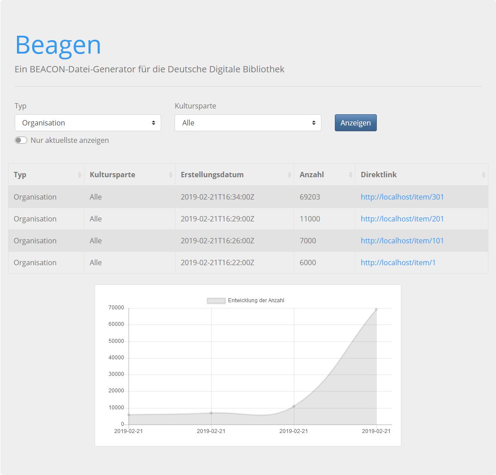

 
# Beagen: A Beacon file generator for Deutsche Digitale Bibliothek
A Beacon file generator for [Deutsche Digitale Bibliothek](https://www.deutsche-digitale-bibliothek.de/). For more information about Beacon files see [this draft](http://gbv.github.io/beaconspec/beacon.html).

*Visit Beagen at DDBlabs:* https://labs.ddb.de/app/beagen
## See also
- GitHub: https://github.com/mbuechner/beagen
- Maven site: https://mbuechner.github.io/beagen/ 

## Screenshot


# Docker

Run the image from GitHub Container Registry.

```sh
docker run -d -p 8080:8080 \
    --volume beagen:/home/beagen/files \
    ghcr.io/mbuechner/beagen:latest
```

Open http://localhost:8080/. Reuse the `beagen` volume when replacing the container to retain the H2 database.

## Environment variables

| Variable | Description |
|----------|-------------|
| `beagen.baseurl` | Public URL used to construct BEACON links, without a trailing slash. Defaults to `http://localhost:8080`. |
| `beagen.pathprefix` | Application path prefix, such as `/beagen` when the proxy forwards that prefix. Defaults to an empty prefix. |
| `beagen.port` | HTTP listening port. Defaults to `8080`. |
| `beagen.cron` | [Quartz cron expression](https://www.quartz-scheduler.org/documentation/quartz-2.3.0/tutorials/tutorial-lesson-06.html) for checking for DDB updates. Defaults to daily at noon. |
| `beagen.database` | H2 JDBC URL suffix (the part after `jdbc:h2:`). The default file is stored under `./files/database/`. |

## Container build

To build and run the image locally, run these commands.

```sh
git clone https://github.com/mbuechner/beagen
cd beagen
docker build -t beagen .
docker run -d -p 8080:8080 \
    --volume beagen:/home/beagen/files \
    beagen
```

## Docker stack

Use the following configuration for a single-node [Docker Swarm](https://docs.docker.com/engine/swarm/stack-deploy/).

```yaml
version: "3.8"
services:
  beagen:
    image: ghcr.io/mbuechner/beagen:latest
    volumes:
      - beagen:/home/beagen/files
    ports:
      - "8080:8080"
volumes:
  beagen:
```

# Maven

Beagen uses Java 25 LTS (JDK) and Maven 3.9 or later. To build the executable JAR, run this command from the directory containing `pom.xml`.

```sh
mvn clean package
```

Start the web server with this command and open http://localhost:8080/.

```sh
java -jar target/beagen.jar
```

To use the development settings, including the once-per-minute update schedule, start with `java -Dbeagen.dev=true -jar target/beagen.jar`.
